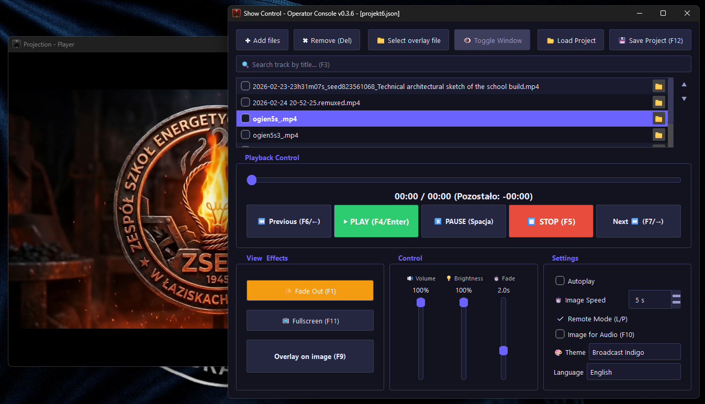

# Show Control – Operator Console

**A professional dual-screen multimedia playback application for live events, presentations, performances and broadcast environments.**

[](https://www.python.org/)
[](https://www.riverbankcomputing.com/software/pyqt/)
[](https://www.videolan.org/vlc/)
[](LICENSE)

Show Control is a desktop application designed for operators who need reliable and convenient control over multimedia playback during live events.

It separates the operator interface from the audience-facing projection screen, allowing you to manage playlists, control playback, adjust audio and video settings, and switch between media and visual overlays without exposing the control panel to your audience.

**One screen for the operator. One screen for the audience. Complete control over your show.**

## Overview

Show Control is suitable for:

- Live events and stage performances
- School assemblies and ceremonies
- Conferences and presentations
- Concerts and music events
- Broadcast and multimedia productions
- Public events and exhibitions

## Key Features

### Dual-Screen Operation

- Automatically detects a second display.
- Opens a dedicated projection window on the secondary screen.
- Displays media in fullscreen mode.
- Keeps the operator console separate from the audience-facing display.
- Allows switching between fullscreen and windowed projection.
- Supports temporarily hiding and restoring the projection window.

### Multimedia Playback

Powered by **LibVLC** through the `python-vlc` library.

Supported media formats include:

| Type | Formats |
|---|---|
| Video | MP4, MKV |
| Audio | MP3, WAV, FLAC, AAC, OGG, M4A |
| Images | JPG, JPEG, PNG, BMP, GIF |

Playback features:

- Play, pause and stop controls.
- Previous and next media navigation.
- Playback progress indicator and seeking.
- Real-time volume adjustment.
- Automatic playback of the next playlist item.
- Configurable display duration for images.
- Independent playback engines for primary media and video overlays.

### Playlist Management

- Add media files using the file browser.
- Drag and drop files from Windows Explorer.
- Reorder playlist items using drag and drop.
- Search and filter playlist entries in real time.
- Highlight the currently playing item.
- Configure overlay behaviour individually for playlist entries.
- Remove unwanted items from the playlist.

### Visual Overlays and Branding

Display a logo, static image or looping video instead of the main projection.

Supported overlay formats:

- Static images: PNG, JPG, JPEG, BMP, GIF.
- Video: MP4, MKV.

Additional capabilities:

- Display a logo during audio playback.
- Toggle the overlay independently of the current playlist item.
- Play video overlays continuously in a loop without audio.
- Adjust overlay brightness.
- Automatically activate overlays for selected playlist entries.

This is particularly useful for displaying event branding, school or company logos, sponsor graphics, and visual backgrounds between presentations.

### Smooth Fade Out

A dedicated fade-out effect provides professional transitions when stopping media.

- Gradually reduces audio volume to zero.
- Simultaneously dims the projected video.
- Adjustable transition duration from 0.2 to 2.0 seconds.
- Restores the configured projection brightness after the transition.

### Audio and Video Controls

The operator console provides three independent controls:

| Control | Range | Description |
|---|---|---|
| Volume | 0–100% | Real-time audio volume |
| Brightness | 0–100% | Projection brightness and contrast |
| Fade | 0.2–2.0 s | Fade-out duration |

### Autoplay and Remote Control

- Automatically advances to the next playlist item.
- Configurable image display duration (1–60 seconds).
- Remote-control navigation mode using left and right arrow keys.
- Standard navigation mode using up and down arrow keys.

### User Interface and Themes

Four built-in interface themes:

- Studio Dark
- Studio Light
- Red Night (Stealth)
- Broadcast Indigo

Additional features:

- English and Polish interface languages.
- Persistent theme and language preferences.
- Visual button feedback after keyboard or mouse interaction.
- Operator-focused interface designed for quick access to essential controls.

### Project Management

Save and restore complete playback configurations.

Projects are stored as JSON files and include:

- Playlist entries and file paths.
- Per-item overlay configuration.
- Overlay media path.

Other features:

- Load previously saved projects.
- Automatically restore the last opened project.
- Check media file availability when loading projects.
- Maintain backward compatibility with older project formats.
- Save the current project using F12.

## Keyboard Shortcuts

| Shortcut | Action |
|---|---|
| F1 | Fade Out and Stop |
| F2 | Focus playlist |
| F3 | Focus search field |
| F4 / Enter | Play selected item |
| Space | Play / Pause |
| F5 | Stop |
| F6 | Previous item |
| F7 | Next item |
| F9 | Toggle overlay |
| F10 | Toggle image for audio |
| F11 | Toggle projection fullscreen |
| F12 | Save project |
| Delete | Remove selected playlist item |
| Up / Down | Playlist navigation (standard mode) |
| Left / Right | Playlist navigation (remote mode) |

## Screenshots



## Technology Stack

Show Control is built with Python and uses established multimedia and desktop application technologies.

| Technology | Purpose |
|---|---|
| Python 3.10+ | Application logic |
| PyQt6 | Graphical user interface |
| LibVLC | Multimedia playback engine |
| python-vlc | Python bindings for VLC |
| JSON | Project configuration and playlist storage |
| QSettings | Persistent application preferences |

The application uses separate VLC player instances for primary media playback and visual overlays.

## Installation

### Requirements

- Windows 10 or Windows 11 (64-bit recommended).
- Python 3.10 or newer.
- VLC Media Player (64-bit).
- A second monitor or projector for dual-screen operation.

**Important:** The VLC Media Player installation must match the architecture of your Python environment. A 64-bit Python installation requires 64-bit VLC.

Download VLC:

https://www.videolan.org/vlc/

### Run from Source

1. Clone the repository:

```bash
git clone https://github.com/debowski/Show-control.git
cd Show-control
```

2. Create a virtual environment:

```bash
python -m venv .venv
```

3. Activate the environment:

```bash
.venv\Scripts\activate
```

4. Install dependencies:

```bash
pip install -r requirements.txt
```

5. Run the application:

```bash
python main.py
```

### Build an Executable

The project includes a PyInstaller specification file.

Install PyInstaller:

```bash
pip install pyinstaller
```

Build the application:

```bash
pyinstaller ShowControl.spec
```

The executable will be generated in the `dist` directory.

Note: VLC runtime libraries must also be available on the target computer.

## Usage

1. Connect a second monitor or projector to your computer.
2. Set Windows display mode to **Extend these displays**.
3. Launch Show Control.
4. Add media files to the playlist.
5. Select an overlay image or looping video if required.
6. Configure volume, brightness and playback options.
7. Start playback using the operator console.
8. Control the presentation using the graphical interface or keyboard shortcuts.

The audience sees only the projection window, while the operator retains full control through the main application window.

## Troubleshooting

| Problem | Possible solution |
|---|---|
| VLC library cannot be loaded | Install VLC Media Player and check that its architecture matches Python. |
| No projection on the second screen | Set Windows display mode to Extend these displays. |
| Media file does not play | Check the file format and whether the file is accessible. |
| Projection window is hidden | Use the Show/Hide Projection Window control. |
| No audio at playback start | Check the volume setting and Windows audio output device. |
| Video overlay does not loop | Verify that the overlay file is supported and not corrupted. |

## Project Status

Show Control is actively developed. The current source code version is **0.3.7**.

The project is intended to evolve with additional functionality and improvements based on practical use in live event environments.

## License

This project is licensed under the **GNU General Public License v3.0 (GPL-3.0)**.

See the [LICENSE](LICENSE) file for details.

Copyright © 2026 Piotr Dębowski.

## Links

- **GitHub Repository:** https://github.com/debowski/Show-control
- **Project Website:** https://debowski.github.io/showcontrol/
- **VLC Media Player:** https://www.videolan.org/vlc/
- **Python:** https://www.python.org/

---

**Show Control – Professional Multimedia Playback for Live Events.**